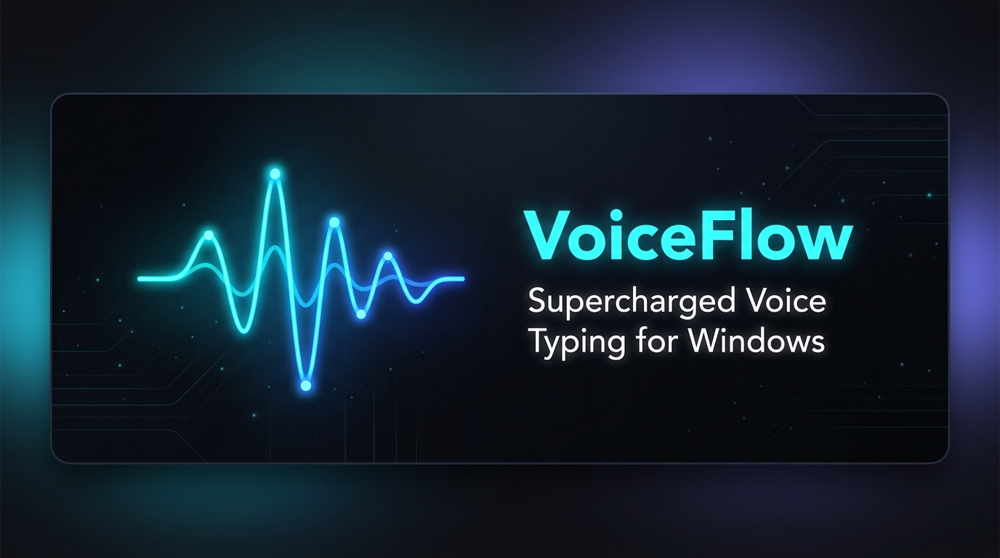
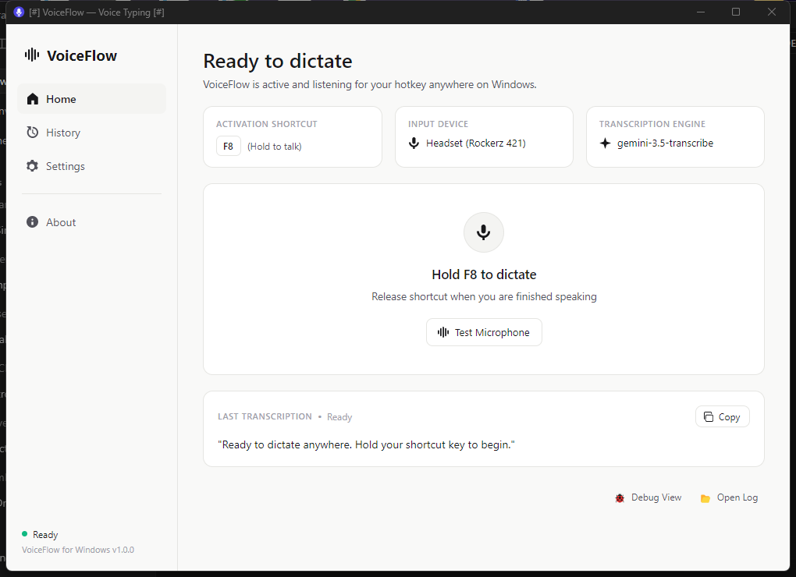
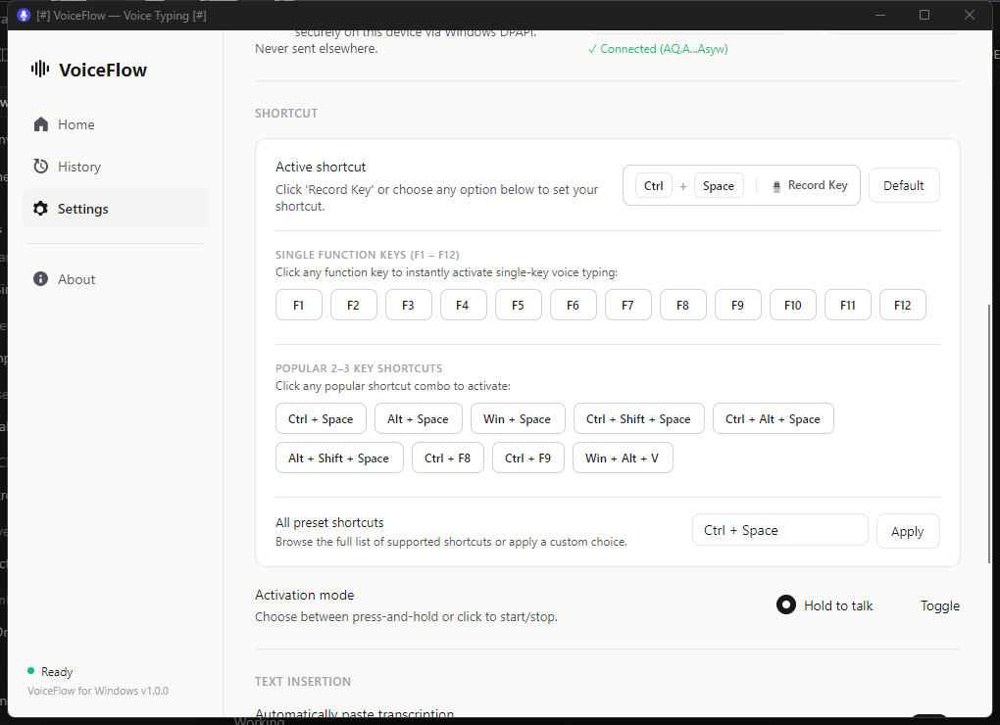
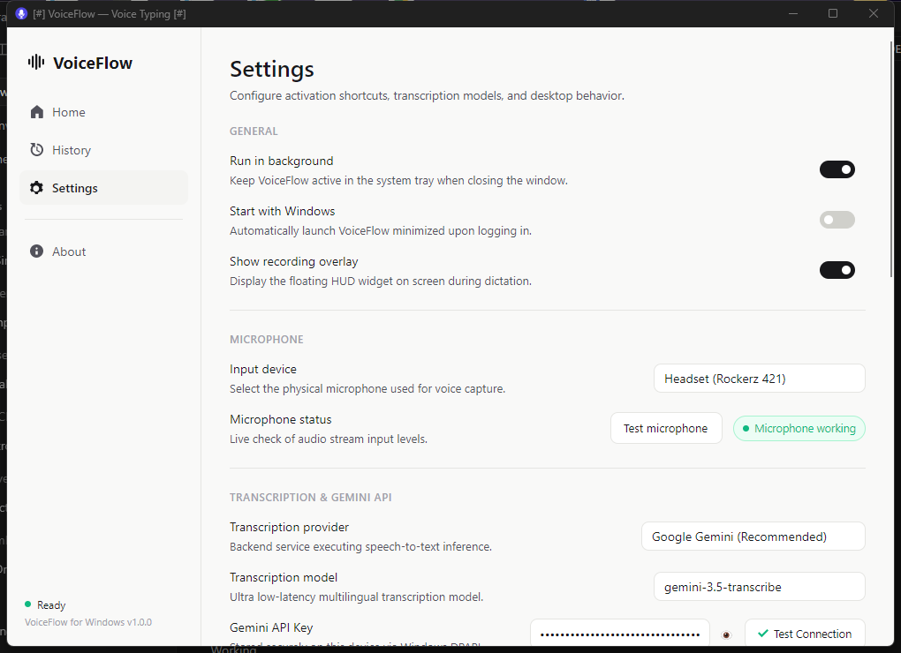
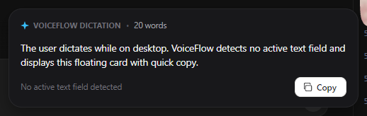
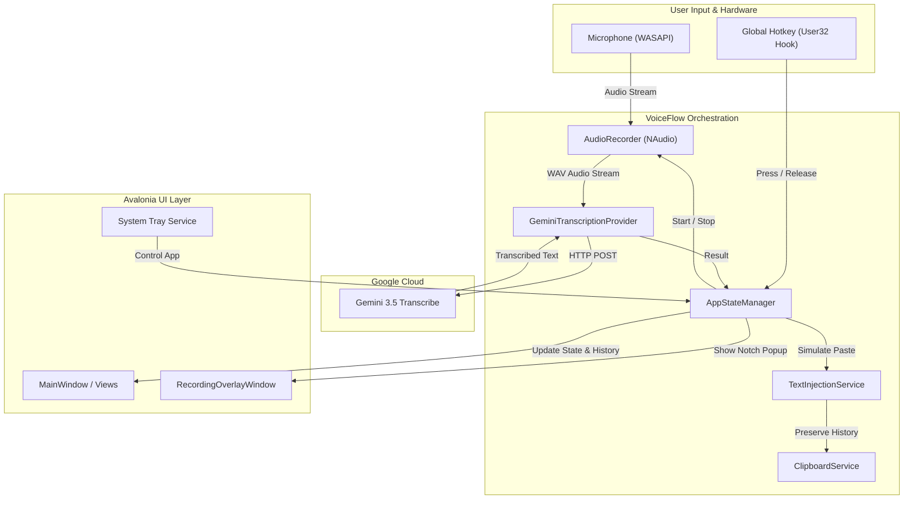

<p align="center">
  
</p>

<p align="center">
  
</p>

<h1 align="center">VoiceFlow</h1>

<p align="center">
  <strong>Next-Generation Voice Typing & Multilingual Dictation for Windows powered by Google Gemini 3.5 Transcribe.</strong>
</p>

<p align="center">
  <a href="https://dotnet.microsoft.com/download/dotnet/8.0"></a>
  <a href="https://avaloniaui.net/"></a>
  <a href="https://ai.google.dev/"></a>
  <a href="#"></a>
  <a href="LICENSE"></a>
  <a href="https://github.com/actions"></a>
</p>

---

## 🌟 Overview

**VoiceFlow** is a modern, ultra-low-latency desktop voice typing and speech-to-text assistant engineered for Windows. Powered by Google's state-of-the-art **Gemini 3.5 Transcribe** multimodal model and native Windows audio streaming, VoiceFlow enables seamless system-wide dictation directly into any application, code editor, browser, or chat window.

Whenever you trigger your global shortcut, VoiceFlow captures high-fidelity audio via WASAPI, streams it directly for fast transcription, and automatically pastes the result right where your cursor is located—all while preserving your previous clipboard contents. If no active text input is focused, VoiceFlow automatically summons an intelligent floating notch card displaying your text with an instant one-click copy button.

---

## ✨ Key Features

- ⚡ **Gemini 3.5 Transcribe Cloud STT**: Instant speech recognition across 100+ languages with exceptional punctuation accuracy, domain term handling, and background noise resilience.
- ⌨️ **Flexible Global Hotkeys**:
  - **Single Function Keys**: One-tap activation using `F1` through `F12`.
  - **Multi-Key Combinations**: Full support for 2-3 key combos like `Ctrl + Space`, `Alt + Space`, `Win + Space`, `Ctrl + Shift + Space`, `Win + Alt + V`, and more.
  - **Shortcut Editor**: Click each of three key boxes to capture one key, then save a one-, two-, or three-key shortcut.
  - **Independent Shortcuts**: Configure **Hold-to-talk** and **Toggle** separately; both stay active together.
- 🪟 **Context-Aware Text Injection & Floating Notch HUD**:
  - **Direct Text Injection**: Injects transcribed text into the focused window using simulated input without overwriting the user's existing clipboard contents.
  - **Wispr-Style Floating Notch Card**: When dictating without a focused text field, VoiceFlow pops up an unobtrusive, elegant floating notch card showing transcription preview, word count, and a 1-click **Copy** button.
- 🎨 **Modern Fluent UI & Penpot Design System**:
  - Crafted with Avalonia UI 11 following clean typography, dark/light contrast, responsive layouts, and smooth animations.
  - Dedicated views for **Home**, **History**, **Settings**, and **About**.
- 🛡️ **Enterprise-Grade Security**:
  - API keys are encrypted at rest using Windows DPAPI (`CryptProtectData`), guaranteeing keys are stored safely and never written in plaintext.
- 🎙️ **Low-Latency WASAPI Audio Capture**:
  - Live audio meter and test utility for verifying microphone level and input latency before dictating.
- 🚀 **Background System Tray Agent**:
  - Closes to tray to keep memory footprint light; quickly access settings or trigger dictation from the taskbar notification area.

---

## 📸 Screenshots Gallery

| Home Dashboard | Shortcut Management |
| :---: | :---: |
|  |  |
| *Real-time status, active shortcut badge, and dictation prompt* | *Single function keys (F1-F12), combo chips, and key recorder* |

| Settings Panel | Floating Notch Card |
| :---: | :---: |
|  |  |
| *General toggles, microphone level test, and Gemini API setup* | *Unfocused input fallback card with word count and 1-click copy* |

---

## 📋 System Requirements

- **Operating System**: Windows 10 (version 19041 or higher) or Windows 11 (64-bit).
- **Runtime**: [.NET 8.0 Runtime](https://dotnet.microsoft.com/download/dotnet/8.0) (or use self-contained release executable).
- **Hardware**: Working microphone or headset (USB, 3.5mm, or Bluetooth).
- **Gemini API Key**: A free or paid API key from [Google AI Studio](https://aistudio.google.com/).

---

## 🚀 Quick Start

### 1. Download & Launch
Choose the package that best fits your workflow:
- 🚀 **Windows Installer (Recommended)**: Download **`VoiceFlow-v1.1.3-Setup.exe`** from [GitHub Releases](https://github.com/arunmauryaz/VoiceFlow/releases). Runs a quick setup wizard, creates Start Menu & Desktop shortcuts, and enables seamless system integration.
- 📦 **Portable ZIP**: Download **`VoiceFlow-v1.0.0-win-x64.zip`** from [GitHub Releases](https://github.com/arunmauryaz/VoiceFlow/releases), extract to any folder, and double-click `VoiceFlow.exe` to run anywhere without installation.

### 2. Enter Gemini API Key
1. In the VoiceFlow navigation sidebar, open **Settings**.
2. Scroll to **Transcription & Gemini API**.
3. Paste your Gemini API key from [Google AI Studio](https://aistudio.google.com/).
4. Click **Test Connection** to verify that your key is active and connected.

### 3. Choose Your Shortcuts
1. Open **Settings -> Shortcut** and select **Hold to talk** to edit its shortcut.
2. Click a key box and press one key. Fill one, two, or three boxes; use the × button to remove a key.
3. Click **Save & Activate Shortcut**.
4. Select **Toggle** and configure its own shortcut the same way. Both shortcuts remain active together.

For example, use **Shift + Ctrl + Win** for hold-to-talk and **F10** for toggle.
Release any key of the hold shortcut to finish; press the toggle shortcut again to finish.
The mode selector only chooses which shortcut you are editing. Unsaved edits remain
in their respective editors when switching modes. Escape cancels key capture.
Duplicate keys, overlapping Hold/Toggle shortcuts, and known reserved Windows
combinations are rejected with an explanation. Existing installations retain their
previous shortcut; fresh installations use Ctrl + Space for Hold and F10 for Toggle.

### 4. Dictate Anywhere!
- Focus any text field (VS Code, Slack, Word, Discord, Browser, Terminal, etc.).
- Press and hold your shortcut key, speak naturally, and release.
- VoiceFlow will transcribe and type your text in real time!

---

## 🛠️ Building From Source

### Local speech recognition

Choose **Local models (offline)** under **Settings → Transcription**, then select
a model. Missing weights and the required backend are downloaded automatically.
Startup prepares the selected model in the background and keeps it loaded for
dictation. Setup status and progress appear below the selector.

| Model | Weight download | Language |
| --- | ---: | --- |
| Whisper Tiny | 78 MB | Multilingual |
| Whisper Base | 148 MB | Multilingual |
| Whisper Small Q5 | 190 MB | Multilingual |
| Underdog Bark 3.0 Clean | 180 MB | English |

**Device** defaults to **Default**, which chooses a compatible GPU when available
and falls back to CPU if GPU initialization fails. **CPU** always uses the CPU.
**GPU** requires a compatible device and reports a short error if unavailable.
Whisper uses Vulkan on compatible AMD, Intel, and NVIDIA GPUs. Bark uses NVIDIA
CUDA 12.6 or newer; its Windows backend does not support AMD GPUs. Device changes
replace the background worker without restarting the app.

Runtime installation is automatic. Whisper's CPU backend is bundled; its Vulkan
backend downloads on demand. Bark uses isolated CPU and CUDA environments, with a
private Python 3.11 download if no suitable system Python exists. Setup does not
modify global Python packages. Bark's compressed weights expand to several GB of
RAM, and the first load can take considerably longer than Whisper Tiny.

Once downloaded, **Repair model** verifies setup and downloads a fresh model copy.
**Delete model** stops its worker and deletes that model's weights. Deleted models
stay removed across startup until you choose Download or select the model again.
Other models and shared runtimes remain installed. Setup can be cancelled and retried.

Models live in `%LOCALAPPDATA%\VoiceFlow\Models`; backend environments live next
to that folder. Downloads are pinned and verified before activation. Local
transcription never falls back to Gemini and bypasses Gemini cleanup. Temporary
audio is removed after processing; existing local history behavior is preserved.

References and licenses: [Sotto](https://github.com/smirk-dev/sotto) inspired the
local-model workflow. This implementation uses [Whisper.net](https://github.com/sandrohanea/whisper.net)
and [whisper.cpp models](https://huggingface.co/ggerganov/whisper.cpp).
[Bark Clean](https://huggingface.co/ConwayResearch/Underdog-Bark-3.0-Clean) and the
NVIDIA processor files use CC BY 4.0; attribution is in `VoiceFlow/LocalRuntime/NOTICE`.
Private Python uses the Python Software Foundation license and get-pip uses MIT.
Whisper's native runtime requires Windows 11 or newer, AVX2/FMA/F16C, and the
Visual C++ 2022 x64 redistributable.

### Dictation behavior and background use

In **Settings → Dictation → Text output**, choose **When finished** to insert one
complete transcript, or **Continuous typing** to insert phrases as they are recognized.
Continuous mode recognizes pauses and transcribes non-overlapping audio phrases.
It preserves your wording and skips the separate cloud cleanup pass. Recognition
latency depends on the model and hardware; Whisper Tiny/Base are the fastest
choices for modest CPUs. This is phrase-by-phrase output, not speculative token streaming.

Global shortcuts write into the focused text field. Continuous insertion pauses
if you switch windows or text fields; your full transcript remains available to
copy. Home's Start dictation button previews output inside VoiceFlow. Finishing a
continuous session records a single History entry and does not paste everything
again. The recording notch never takes keyboard focus and displays a smoothed
input meter. Hold shortcuts are supported during live Unicode text insertion.

Audio phrase queues are bounded, and long completed-mode recordings use temporary
files instead of growing RAM buffers. Temporary recordings are removed after use.
Turn **Keep model ready** off to release model workers after three minutes idle;
turn it on to prioritize faster starts. Workers are terminated when the app exits
or crashes. Only one desktop instance runs at a time. Logs rotate at 2 MB.

The monochrome icon's master and exact built-in image-generation prompt are in
`docs/design/voiceflow-icon.png` and `docs/design/icon-prompt.txt`. The executable,
window, sidebar, About page, and tray use the updated icon.

### Build the Windows installer

Run `powershell -ExecutionPolicy Bypass -File .\Build-Release.ps1` from the
repository root. This requires the .NET 8 SDK and Inno Setup 6. It runs the test
suite, publishes a self-contained Windows x64 payload, and compiles
`release/VoiceFlow-v1.1.3-Setup.exe` with a SHA-256 checksum. No .NET installation
is needed on the destination PC. Local model downloads and device setup remain
automatic on first use. Close VoiceFlow before installing or upgrading.

### Prerequisites
- [.NET 8.0 SDK](https://dotnet.microsoft.com/download/dotnet/8.0)
- Visual Studio 2022 (v17.8+), JetBrains Rider, or VS Code with C# Dev Kit.
- Git

### Build Instructions

For one-click local development, double-click **`Run-VoiceFlow.bat`** in the
repository root. It restores dependencies and builds the latest source in Debug
mode before launching; build errors stay visible and prevent an older build
from opening. Install the .NET 8 SDK first (the runtime alone is insufficient).
The first build requires internet access for NuGet packages.

Exit VoiceFlow using its system tray **Exit** command before running the launcher
again; closing the main window can leave the app running. Runtime logs are at
`%APPDATA%\VoiceFlow\voiceflow.log`. You can also pass app arguments from a terminal,
for example `Run-VoiceFlow.bat --settings`.

```powershell
# 1. Clone the repository
git clone https://github.com/arunmauryaz/VoiceFlow.git
cd VoiceFlow

# 2. Restore NuGet dependencies
dotnet restore VoiceFlow.sln

# 3. Build in Release configuration
dotnet build VoiceFlow.sln -c Release

# 4. Run all automated unit and component tests
dotnet test VoiceFlow.Tests/VoiceFlow.Tests.csproj -c Release

# 5. Publish a standalone, self-contained single-file executable
dotnet publish VoiceFlow/VoiceFlow.csproj -c Release -r win-x64 --self-contained true -p:PublishSingleFile=true -o ./publish
```

The published executable will be available at `./publish/VoiceFlow.exe`.

---

## 📂 Repository Structure

```text
WISPER-GEM/
├── .github/
│   └── workflows/
│       └── build.yml               # Automated CI build and test pipeline
├── docs/
│   ├── design/                     # Complete Penpot UI/UX design specifications
│   │   ├── 01 — Design System/     # Color palette, typography, tokens
│   │   ├── 02 — Components/        # Buttons, inputs, switches, cards
│   │   ├── 03 — Home/              # Home screen mockups and layout
│   │   ├── 04 — History/           # History screen and action menus
│   │   ├── 05 — Settings/          # Settings configurations
│   │   ├── 06 — Overlays/          # Floating HUD and notch cards
│   │   ├── 07 — Onboarding/        # First-run onboarding flow
│   │   └── 08 — About/             # About dialogue and system tray
│   └── screenshots/                # Application screenshots, logo, and banner
│       ├── banner.png              # High-res GitHub hero banner
│       ├── logo.png                # App icon / branding logo
│       ├── home.png                # Home dashboard screenshot
│       ├── settings.png            # Settings panel screenshot
│       ├── shortcuts.png           # Shortcut manager screenshot
│       └── floating_notch.png      # Floating notch popup card screenshot
├── VoiceFlow/                      # Core .NET 8 Avalonia Desktop Application
│   ├── Assets/                     # Application icons and vector assets
│   ├── Converters/                 # XAML value converters
│   ├── Helpers/                    # Hotkey formatters, audio waveform utilities
│   ├── Interfaces/                 # Architecture service contracts
│   ├── Models/                     # Data models, Enums, Settings structures
│   ├── Native/                     # Windows Win32 User32 / DPAPI pinvoke APIs
│   ├── Providers/                  # Audio recording and Gemini STT client
│   ├── Services/                   # Hotkey hook, clipboard, tray, state manager
│   ├── ViewModels/                 # MVVM view models (CommunityToolkit.Mvvm)
│   ├── Views/                      # Avalonia XAML views and overlay windows
│   ├── App.axaml                   # Application styles and DI initialization
│   ├── Program.cs                  # Entry point
│   └── VoiceFlow.csproj            # Project configuration
├── VoiceFlow.Tests/                # Automated Test Suite
│   ├── ComponentTests.cs           # ViewModels, converters, state machines
│   ├── FoundationTests.cs          # Models, hotkey parsing, crypto, DPAPI
│   └── VoiceFlow.Tests.csproj      # xUnit test project
├── .gitignore                      # Comprehensive Git ignore rules
├── LICENSE                         # MIT License
├── README.md                       # Repository documentation
└── VoiceFlow.sln                   # Visual Studio solution file
```

---

## 🏛️ Architecture & Subsystems



### Key Components

- **`WindowsHotkeyService`**: Uses a low-level keyboard hook (`SetWindowsHookEx`) to intercept global hotkeys without consuming system resources or blocking keystrokes.
- **`GeminiTranscriptionProvider`**: Communicates with the Google Gemini API using `gemini-3.5-transcribe` with optimal audio headers, low latency, and retry logic.
- **`WindowsTextInjectionService`**: Detects focused text controls via Win32 `GetGUIThreadInfo`. If an active caret is detected, it pastes text and restores the user's prior clipboard within 150 milliseconds.
- **`RecordingOverlayWindow`**: A lightweight topmost overlay rendering both the active microphone audio waveform during recording and the fallback popup card when unfocused.
- **`SettingsService`**: Manages user configuration in `%LocalAppData%/VoiceFlow/settings.json` with DPAPI encryption for credentials.

---

## 🧪 Testing

VoiceFlow includes an extensive automated test suite built with **xUnit**:

```powershell
dotnet test VoiceFlow.Tests/VoiceFlow.Tests.csproj
```

The test suite validates:
- Hotkey parsing, conflict detection, single-key F1-F12 validation, and combination formatting.
- Overlay state machine transitions and transcription popup timers.
- WASAPI and Gemini transcription provider response parsing.
- Settings persistence, validation, and DPAPI key encryption round-trips.
- Text injection and clipboard restoration logic.

---

## 🤝 Contributing

Contributions are welcome! Please follow these steps:

1. **Fork** the repository.
2. Create your feature branch (`git checkout -b feature/awesome-feature`).
3. Commit your changes (`git commit -m "Add awesome feature"`).
4. Run all tests to ensure zero regressions (`dotnet test`).
5. Push to your branch (`git push origin feature/awesome-feature`).
6. Open a **Pull Request**.

---

## 📄 License

This project is licensed under the **MIT License** - see the [LICENSE](LICENSE) file for details.

---

<p align="center">
  Built with ❤️ using <strong>.NET 8</strong>, <strong>Avalonia UI</strong>, and <strong>Google Gemini</strong>.
</p>

### Local model loading

Local workers use below-normal process priority and up to four CPU threads, leaving
capacity for foreground apps. Device changes settle for one second before setup;
Default and an equivalent explicit device reuse the resident model. A real change
between CPU and GPU needs a new worker. Models release after 15 idle minutes unless
Keep model ready is enabled.

Bark creates an optional decoded weight cache beside its compressed model when disk
space permits (roughly 2.5 GB extra). Later launches memory-map it instead of decoding
again. Delete removes both files; Repair rebuilds the cache. Cache failure falls back
to the compressed model. First loading is still slower than loading a small Whisper
model, and keeping a model ready retains its RAM until idle release or app exit.
