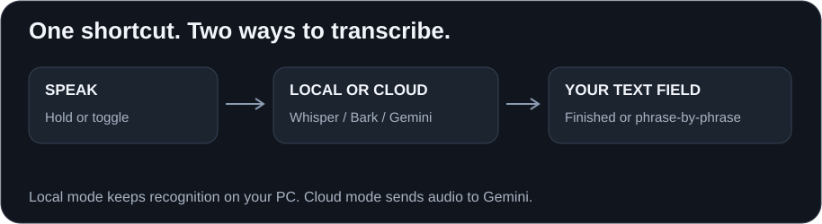
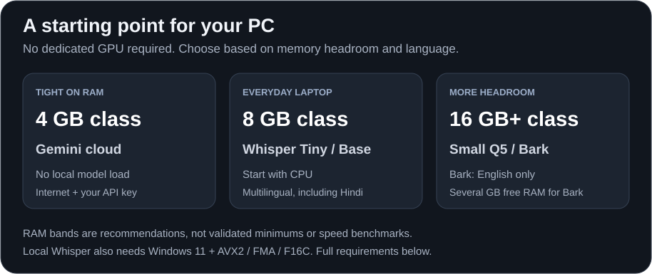
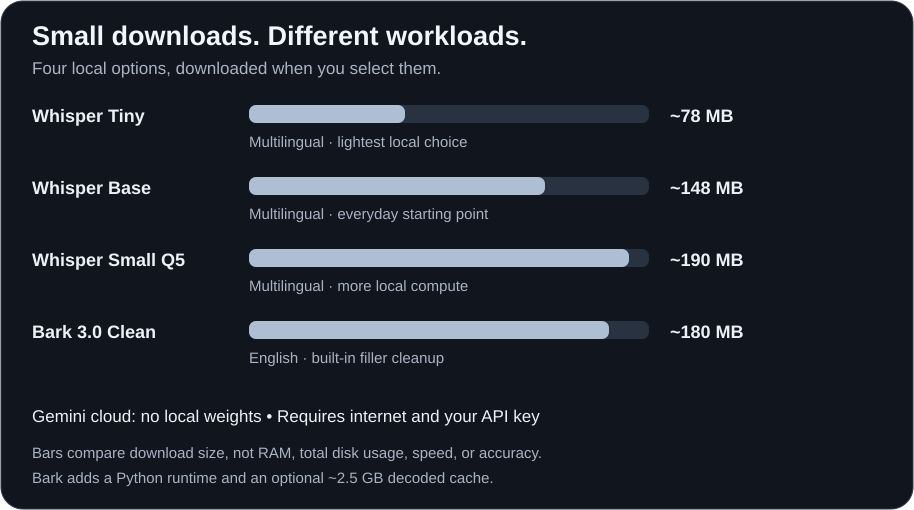

<h1 align="center">Your voice. Your models. Your Windows PC.</h1>

Open-source dictation with local Whisper / Bark or Gemini cloud.

  
  
  
  

  <a href="https://github.com/arunmauryaz/VoiceFlow/releases/download/v1.1.4/VoiceFlow-v1.1.4-Setup.exe"><strong>Download installer</strong></a> ·
  <a href="https://github.com/arunmauryaz/VoiceFlow/releases/download/v1.1.4/VoiceFlow-v1.1.4-win-x64.zip">Portable ZIP</a> ·
  <a href="https://github.com/arunmauryaz/VoiceFlow/releases/latest">What's new</a> ·
  <a href="https://github.com/arunmauryaz/VoiceFlow/issues">Feedback</a>

Speak into the text field you're already using. Choose on-device recognition or
Gemini, then use a hold or toggle shortcut. No VoiceFlow subscription; Gemini API
usage may incur provider charges.

| ⌨️ Your shortcuts | 🎙️ Your output | 🪟 Your workspace |
| :--- | :--- | :--- |
| Independent hold + toggle; 1–3 keys | When finished or continuous phrases | Floating waveform, History, light/dark themes |

## Which PC can use it?

**Minimum platform requirements**

| Mode | Required |
| --- | --- |
| App + Gemini | Windows 10 build 19041+ or Windows 11, **x64**, microphone, internet + your Gemini API key |
| Local Whisper | **Windows 11**, x64 CPU with **AVX / AVX2 / FMA / F16C**, [VC++ 2022 x64 runtime](https://aka.ms/vs/17/release/vc_redist.x64.exe) |
| GPU acceleration | Optional. Whisper: compatible **Vulkan** GPU. Bark: compatible **NVIDIA GPU + CUDA driver 12.6+** |

The RAM bands above are starting recommendations; a validated minimum across all
PCs has not been established. Local setup needs internet once. The app is Windows
x64 only; native Windows ARM packages are not provided. [Hardware details →](docs/GUIDE.md#hardware-and-models)

## Models available today

**Start with Whisper Tiny or Base** for local dictation. Choose Small Q5 when you
have more compute headroom; choose Bark for English speech with built-in filler
cleanup. Select **Default / CPU / GPU** in Settings; setup, Repair, and Delete are built in.

| Disk use | What to expect |
| --- | --- |
| App, including .NET + uninstaller | About **195 MB** |
| Whisper | Model weights above; optional GPU backend adds storage |
| Bark | Weights **plus several GB** for its Python runtime and optional **~2.5 GB decoded cache** |

Local audio recognition stays on your PC and never falls back to Gemini. Cloud
mode sends audio to Gemini. Transcripts are kept in local History.
[Storage and privacy →](docs/GUIDE.md#storage-and-privacy)

## How does it compare?

A feature comparison, **not an accuracy or speed ranking**. Checked against official
sources on **26 October 2026**. Products and plans can change.

| | **VoiceFlow** | **Wispr Flow** | **Handy** | **Windows voice typing** |
| --- | --- | --- | --- | --- |
| Platforms | Windows x64 | Windows, macOS, iOS, Android | Windows, macOS, Linux | Windows |
| Speech recognition | Local **or** Gemini | Cloud | Local | Cloud |
| Offline after setup | ✅ Local models | — | ✅ | — |
| Engine choice | Whisper / Bark / Gemini | Managed by service | Whisper / Parakeet | Managed by Windows |
| Cost | Free app; API usage extra | Free + paid plans | Free, open source | Included with Windows |
| A good fit for | Local/cloud choice on Windows | Managed cross-device dictation | Offline desktop dictation | Built-in online dictation |

Sources: [Wispr platforms](https://docs.wisprflow.ai/articles/1036674442-supported-devices-and-system-requirements),
[cloud processing](https://wisprflow.ai/enterprise-privacy),
[plans](https://docs.wisprflow.ai/articles/9559327591),
[Handy](https://github.com/cjpais/Handy),
[Windows voice typing](https://support.microsoft.com/en-us/accessibility/windows/use-voice-typing-to-talk-instead-of-type-on-your-pc).
Windows **Voice Access** is a separate feature with offline support; this table compares **Win + H voice typing**.

## From download to dictation

| 1 · Install | 2 · Choose | 3 · Speak |
| --- | --- | --- |
| Run the installer or extract the full ZIP | Settings → Transcription → local model or Gemini | Focus a text field; hold **Ctrl + Space** or toggle **F10** |

These are fresh-install shortcuts; existing shortcuts are preserved. Under
**Settings → Dictation**, choose **When finished** or **Continuous typing**.

**Esc** hides the notch. Your next shortcut restores listening; if the dismissed
session is processing, it starts a fresh recording. Home previews text inside the app.

Install notes

Close the tray app before upgrading. .NET is included; no SDK or separate .NET
installation is needed. The installer is unsigned. Verify downloads using the
release's `SHA256SUMS.txt`. Install into a separate app folder, not a source checkout.

## Built in public, improving continuously

We ship incremental fixes to reliability, model loading, shortcuts, and the UI.
Current focus: broader hardware validation and smoother everyday dictation.
Follow **[Releases](https://github.com/arunmauryaz/VoiceFlow/releases)** or report your
PC specs and reproduction steps in **[Issues](https://github.com/arunmauryaz/VoiceFlow/issues)**.
New builds are published on GitHub; install the latest release to update.

| Already shipped | Latest maintenance |
| --- | --- |
| Local models · cloud mode · continuous phrases · independent shortcuts · flowing notch | **v1.1.4:** automatic build cleanup + safer installation folders |

[Changelog](CHANGELOG.md) · [Setup, hardware, privacy & troubleshooting](docs/GUIDE.md) · [Build from source](docs/GUIDE.md#build-and-debug)

Credits & licensing

VoiceFlow is [MIT licensed](LICENSE). Thanks to [Sotto](https://github.com/smirk-dev/sotto)
for local-model workflow inspiration, [Whisper.net](https://github.com/sandrohanea/whisper.net),
[whisper.cpp](https://github.com/ggml-org/whisper.cpp), and
[Conway Research's Bark Clean](https://huggingface.co/ConwayResearch/Underdog-Bark-3.0-Clean).
Bark and NVIDIA processor attribution: [CC BY 4.0 notice](VoiceFlow/LocalRuntime/NOTICE).
Python uses the PSF license; get-pip uses MIT. [Icon source & prompt](docs/design/).

