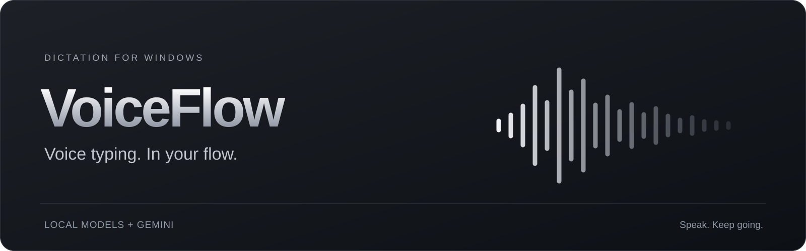

<p align="center">
  
</p>
<p align="center">
  
</p>
<h1 align="center">VoiceFlow</h1>
<p align="center">Local and cloud voice typing for Windows.</p>
<p align="center">
  <a href="https://github.com/arunmauryaz/VoiceFlow/releases/latest"></a>
  
  <a href="LICENSE"></a>
</p>
<p align="center">
  <a href="https://github.com/arunmauryaz/VoiceFlow/releases/download/v1.1.4/VoiceFlow-v1.1.4-Setup.exe"><strong>Download installer</strong></a>
  &nbsp; · &nbsp;
  <a href="https://github.com/arunmauryaz/VoiceFlow/releases/download/v1.1.4/VoiceFlow-v1.1.4-win-x64.zip">Portable ZIP</a>
  &nbsp; · &nbsp;
  <a href="https://github.com/arunmauryaz/VoiceFlow/releases/latest">Release notes</a>
</p>

VoiceFlow turns speech into text in your focused text field. Choose a local Whisper
or Underdog Bark model, or use Gemini with your own API key. Use a hold shortcut,
a toggle shortcut, or the Home screen to start dictation.

## Recent improvements

- **Smaller development footprint.** Release builds clean up their temporary files;
  the installer keeps app files separate from source checkouts.
- **Faster local loading.** Reuse resident models and skip unnecessary reloads for
  equivalent Default/CPU selections. Rapid device changes settle before setup.
- **Bark loading cache.** Later starts reuse decoded, memory-mapped weights. On the
  development PC, Ready took about 8 seconds with cache versus 52 seconds decoding
  without it. Timings depend on hardware; the first cache build takes longer.
- **Escape and restart.** Esc instantly hides the notch. The next shortcut press
  restores listening, or starts a fresh recording if the dismissed session is
  processing. Superseded results cannot overwrite the new session.
- **Flowing waveform.** A microphone-driven waveform travels left to right while
  listening; its animation stops when hidden.

See [CHANGELOG.md](CHANGELOG.md) for the full release summary.

## Features

- **Local or cloud transcription:** Whisper Tiny, Base, Small Q5, Underdog Bark
  3.0 Clean, and Gemini. Local transcription stays local and never falls back to
  cloud transcription or Gemini cleanup.
- **Two independent shortcuts:** configure hold-to-talk and toggle separately.
  Click each key box to build a shortcut using one, two, or three keys.
- **Two output modes:** insert a complete transcript **When finished**, or use
  **Continuous typing** to insert phrases as pauses are recognized.
- **Automatic model setup:** select a model to download it. Select Default, CPU,
  or GPU; the required backend is prepared automatically. Repair and Delete are
  available after download.
- **A compact recording notch:** live waveform, duration, processing state, and a
  copyable result when a text field is unavailable.
- **Light and dark themes, local History, and a tray app.** Closing the window
  keeps VoiceFlow available; use the tray's Exit command to quit.
- **Background efficiency:** bounded audio queues, temporary recording files,
  below-normal worker priority, and a maximum of four CPU threads per worker.

## Install

Download the **[v1.1.4 installer](https://github.com/arunmauryaz/VoiceFlow/releases/download/v1.1.4/VoiceFlow-v1.1.4-Setup.exe)**,
or extract the **[portable ZIP](https://github.com/arunmauryaz/VoiceFlow/releases/download/v1.1.4/VoiceFlow-v1.1.4-win-x64.zip)**
and launch `VoiceFlow.exe`. Keep all portable files together.

Close the existing app from its tray before upgrading. Both packages include
.NET; a separate .NET installation is not required. The installer is unsigned.
SHA-256 checksums are attached to the release as `SHA256SUMS.txt`.

### Requirements

- Windows 10 version 19041 or newer, or Windows 11, x64, and a microphone.
- Local Whisper's native backend requires Windows 11, AVX2/FMA/F16C, and the
  [Visual C++ 2022 x64 redistributable](https://aka.ms/vs/17/release/vc_redist.x64.exe).
- Internet for initial model/backend downloads, or whenever using Gemini.
- A [Gemini API key](https://aistudio.google.com/) only when choosing Gemini.
- Bark expands to several GB in memory. Its optional decoded cache uses roughly
  2.5 GB of additional disk space; insufficient cache space falls back to normal loading.

## Get started

1. Open **Settings → Transcription**. Choose **Local models (offline)** and a model,
   or choose Gemini and enter your API key.
2. Keep Device on **Default**, or explicitly select **CPU** or **GPU**.
3. Set your shortcuts. New installations use **Ctrl + Space** for hold-to-talk and
   **F10** for toggle; existing installations keep their saved shortcuts.
4. Focus a text field. Hold your shortcut while speaking, or press the toggle
   shortcut to start and press it again to finish.
5. Under **Settings → Dictation → Text output**, choose **When finished** or
   **Continuous typing**.

Esc dismisses the notch without stopping an active recording. Press your shortcut
again to restore it. If it is processing, the next shortcut starts a new recording
and cancels the previous processing request. The Home button previews text inside
VoiceFlow. Continuous insertion pauses if you move to a different window or text
field; the full recognized transcript remains available to copy.

## Local models

| Model | Weight download | Languages |
| --- | ---: | --- |
| Whisper Tiny | 78 MB | Multilingual |
| Whisper Base | 148 MB | Multilingual |
| Whisper Small Q5 | 190 MB | Multilingual |
| Underdog Bark 3.0 Clean | 180 MB | English |

Default chooses a compatible GPU and falls back to CPU if initialization fails.
Whisper uses Vulkan on compatible AMD, Intel, and NVIDIA GPUs. Bark's GPU backend
requires a compatible NVIDIA GPU and CUDA driver 12.6 or newer; use CPU on AMD.
A genuine CPU/GPU change needs a new worker.

Models live in `%LOCALAPPDATA%\VoiceFlow\Models`. Downloads are pinned and checked
before activation. Bark creates an isolated Python runtime without changing global
Python packages. **Repair model** refreshes setup and weights and rebuilds its cache;
**Delete model** removes the selected weights and decoded cache. Deleted models stay
removed until you download or select them again. Shared runtimes remain installed.

Models release after **15 minutes idle** unless **Keep model ready** is enabled.
Keeping a model ready avoids reloads but retains its memory. Workers exit with the
app, and logs rotate at 2 MB. Local recognition still saves transcripts in History.

## Build and debug

Install the [.NET 8 SDK](https://dotnet.microsoft.com/download/dotnet/8.0).
Double-click **[Run-VoiceFlow.bat](Run-VoiceFlow.bat)** to build the current source
and launch it. Exit the existing tray app first. Build errors stay visible.

```powershell
dotnet restore VoiceFlow.sln
dotnet test VoiceFlow.Tests/VoiceFlow.Tests.csproj -c Release
dotnet run --project VoiceFlow/VoiceFlow.csproj
```

Logs: `%APPDATA%\VoiceFlow\voiceflow.log`.

### Build release packages

Install Inno Setup 6, then run:

```powershell
powershell -ExecutionPolicy Bypass -File .\Build-Release.ps1
```

The script runs the tests, publishes a self-contained Windows x64 folder, and
creates an installer, portable ZIP, checksums, and install notes in `release/`.
Temporary build folders are removed, including after failures. Use `-KeepBuildFiles`
only when debugging packaging. Install into a separate folder, never the source checkout.
Worker scripts and native libraries stay alongside the executable.

## Credits and licenses

VoiceFlow is [MIT licensed](LICENSE). [Sotto](https://github.com/smirk-dev/sotto)
inspired the local-model workflow. Local Whisper uses
[Whisper.net](https://github.com/sandrohanea/whisper.net) and
[whisper.cpp models](https://huggingface.co/ggerganov/whisper.cpp).
[Underdog Bark Clean](https://huggingface.co/ConwayResearch/Underdog-Bark-3.0-Clean)
and its NVIDIA processor files use CC BY 4.0; see
[the bundled attribution](VoiceFlow/LocalRuntime/NOTICE). Python uses the PSF license;
get-pip uses MIT. The icon master and generation prompt are in
[docs/design](docs/design/).
